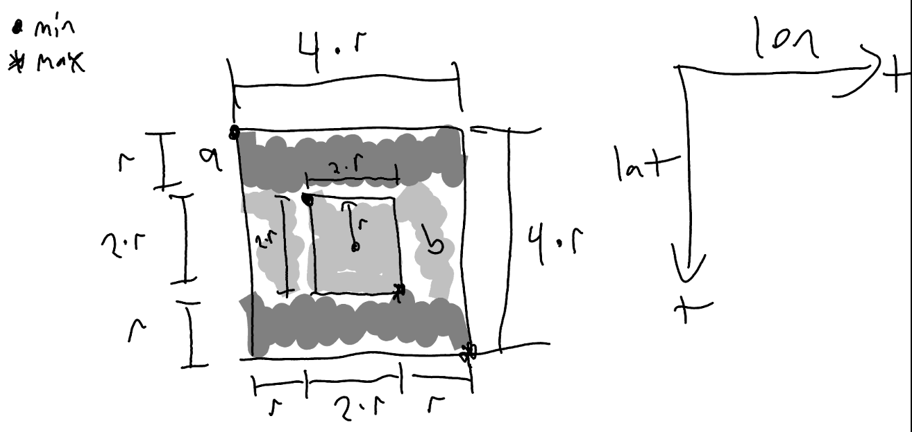

# Data Generation

This folder provides a method for producing geo-tagged data CSV

## Schema

| Column     | Type    |
| ---------- | ------- |
| place_id   | int64   |
| lat        | float64 |
| lon        | float64 |

## Generation

Generating this data we care about specific features in the dataset

- large number of nodes
- nodes are concentrated within bubbles
    - i.e. massive cities (New York) have many more businesses than other places
    - The middle of the ocean should have few/no nodes
- When testing the implementations, we need to have an easy `I` and `R`'s to speed up implementations
    - Should include a unit test bubble, where the businesses returned can be compared to a fixed list
    - [ ] since `place_id` is int64, we can reserve the first 100 to place in a special bubble, and then all others fit around other bubbles.

## How to view on Google Maps

1. Suggest turning on `--include_split`, to allow for colouring data
1. Limit the total rows to under 2000
1. Visit <https://www.google.com/mymaps> and create a new map
1. Import the CSV file to a new LAYER

## Misc

### MATH: Donut Calculation

To distribute points evenly around a donut shape (square with an excluded inner square).

NOTE: this is simplified to square shapes, BUT the bounding boxes drawn on a circle are not straight lines.

#### Shape

- Inner square:
    - center point: $(lat,lon)$
    - radius: $r$
    - area: $4r^2 = (2*r) * (2*r)$
- Outer square:
    - center point: $(lat,lon)$
    - radius: $2r$
    - area: $16r^2 = (2*2r) * (2*2r)$
- Donut Shape
    - Outer square - inner square
    - 2x $a$ rectangles: $a_{top}, a_{bottom}$
    - 2x $b$ rectangles: $b_{left}, b_{right}$
    - total area:
        - $= ((4\cdot r)\cdot (4\cdot r)) - ((2\cdot r) \cdot (2\cdot r))$
        - $= 16r^2 - 4r^2$
        - $=12r^2$
- $a$ rectangle:
    - area: $4r^2 = (4\cdot r)\cdot r$
    - percentage of points: $\frac{1}{3}= \frac{4\cdot r^2}{12\cdot r^2}$
- $b$ rectangle:
    - area: $2r^2 = (2\cdot r)\cdot r$
    - percentage of points: $\frac{1}{6}= \frac{2\cdot r^2}{12\cdot r^2}$